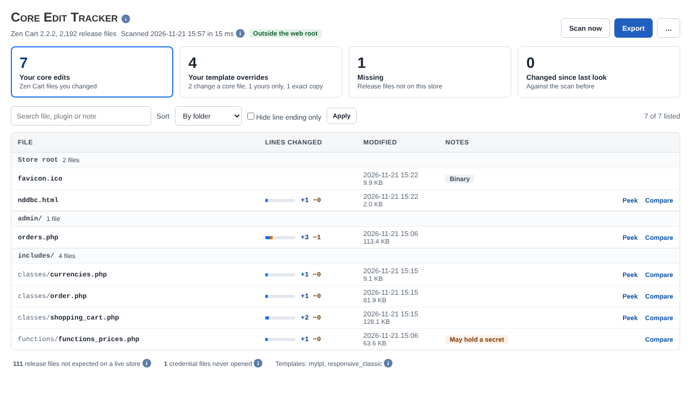
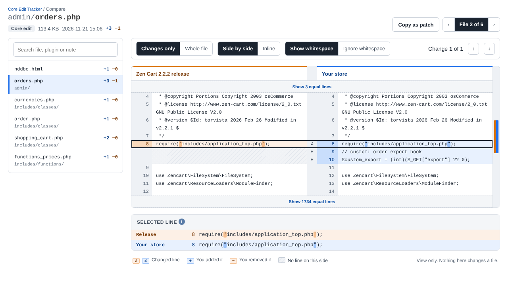
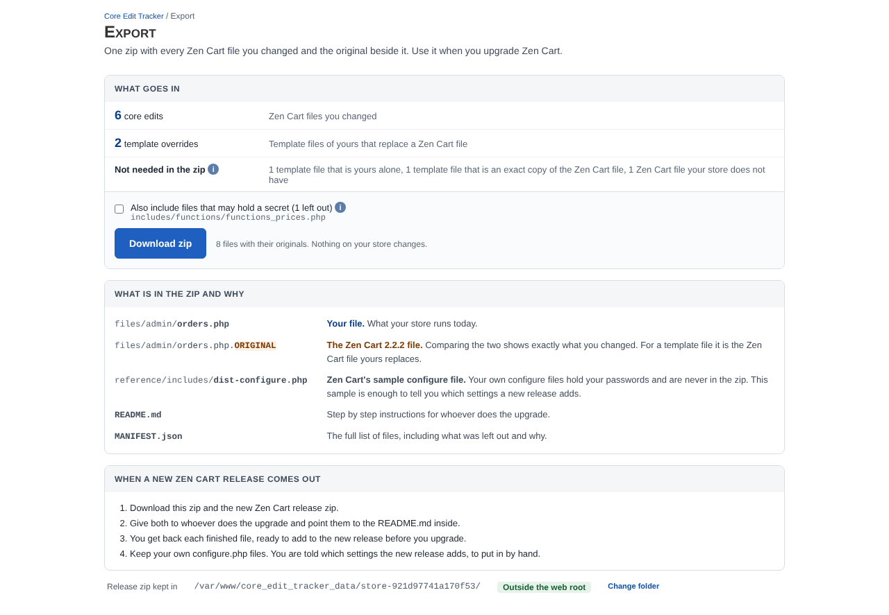
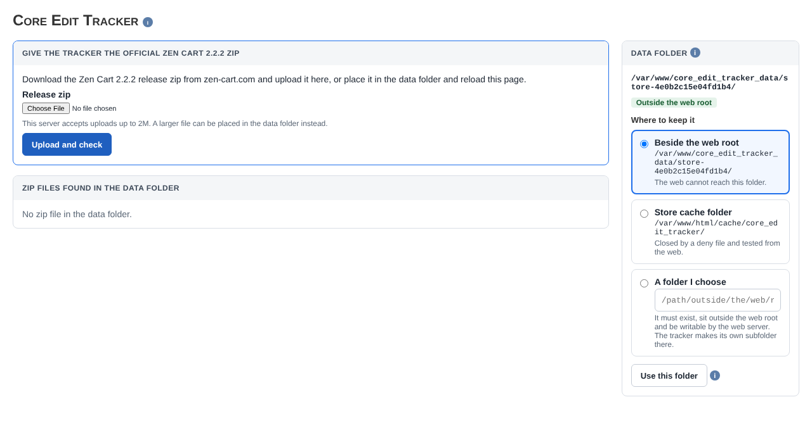

# Core Edit Tracker for Zen Cart


[](https://github.com/CcMarc/CoreEditTracker/blob/main/CHANGELOG.md) [](https://www.php.net/)
[](https://www.zen-cart.com/)
[](https://www.zen-cart.com/license/2_0.txt)
[](https://github.com/CcMarc/CoreEditTracker/commits/main)
[](https://github.com/CcMarc/CoreEditTracker/releases/latest)

Shows which Zen Cart files your store has changed, and packs them up so
your changes can be carried to the next Zen Cart release.

Give it the official Zen Cart zip for the version your store runs, once.
From then on it lists every core file you edited and every template
override, shows each difference side by side, and marks what changed since
your last look. At upgrade time one button exports each of your files with
the original Zen Cart file beside it.

It only reads. It never changes a store file.

## How it presents

- **Tools > Core Edit Tracker**: one admin page.
- **At a glance**: the release in use, the time of the last scan, and a
  count of your core edits, your template overrides, missing files and
  files that changed since the last look.
- **The list**: one line per file, grouped by folder, with its size, date
  and lines added and removed. Search by name, sort, or click Peek to see
  a file's first change without leaving the list.
- **Compare**: the Zen Cart file and your file side by side, like a
  desktop compare tool. Changed lines are highlighted and the exact
  characters that differ are marked.
- **Export**: one zip with each of your files and its original, ready for
  whoever does your upgrade.
- **First visit**: one box that says which zip to give it and where.









## Requirements

- Zen Cart 2.1.0 or later (developed and tested on 2.2.2, see
  [Compatibility](#compatibility))
- PHP 8.0 or later with the zip extension (`ZipArchive`)
- The official Zen Cart zip of the exact version your store runs

## Install

As with any plugin, install on a development or staging copy of your
store first.

1. Upload the `zc_plugins/CoreEditTracker/` folder into your store's
   `zc_plugins/` directory.
2. Admin > Modules > Plugin Manager > Core Edit Tracker > Install.
3. Open Tools > Core Edit Tracker.

The installer creates two tables, one setting and the data folder, and
registers the admin page. It writes no store file.

## Upgrade

Upload the new version folder beside the installed one and use **Upgrade**
in Plugin Manager. The release zip, your scans and the data folder are kept.

## First run

The tracker needs the official zip of the Zen Cart version your store
runs, for example `zencart-2.2.2.zip`. Download it from
[zen-cart.com](https://www.zen-cart.com/) and then do one of these:

- **Upload it** on the page.
- **Place it in the data folder** by FTP or your file manager and reload
  the page. This suits servers whose upload limit is smaller than the zip.
  The page shows the folder's exact path.

The zip is checked before it is kept. It must be a Zen Cart release of the
same version as your store, with no entry that is a symbolic link or that
points outside the zip. A zip that fails is refused with the reason.

The zip is kept whole, under a name nobody can guess. It is never
unpacked, because a release holds PHP files that could be run from the
web. Single files are read from the zip when a difference is shown or an
export is built.

## The data folder

The release zip lives in the data folder. You choose where that is on the
first screen. Later you can change it from the menu beside the Export
button, under Data folder. The zip moves with it.

- **Beside the web root.** A folder named `core_edit_tracker_data` next to
  your web root, outside it, so nothing there can be fetched from the web.
  This is the default when the web server can create it. Each store gets
  its own subfolder, so stores that share a web root stay apart.
- **Store cache folder.** `cache/core_edit_tracker/` inside your store,
  closed by a deny file. The tracker tests it by requesting a small test
  file through your store's own address and shows the result on the page.
- **A folder you choose.** It must exist, sit outside the web root and be
  writable by the web server. The tracker makes its own subfolder there.

If the page says the cache folder could not be tested, check it by hand.
Place a text file in the folder and try to open it in a browser. You
should get an error page, not the file. On a server that does not read
`.htaccess` files (nginx, for one) add a rule that denies web access to
that folder, or pick a folder outside the web root.

## Reading the list

- **Your core edits.** Zen Cart files whose content differs on your store.
- **Your template overrides.** Files in the override folders of every
  template assigned in Tools > Template Selection. Each one is paired with
  the Zen Cart file it replaces. When your template started as a copy of
  another template Zen Cart ships, the closer file is used as the
  original. "Yours only" means Zen Cart has no file by that name. "Exact
  copy" means your file is identical to the Zen Cart file.
- **Owned by a plugin.** Files another plugin declared as its own. This
  group shows only when such a plugin is installed. See
  [For plugin authors](#for-plugin-authors).
- **Missing.** Release files your store does not have. Files Zen Cart
  tells you to remove or not to keep on a live store, such as
  `zc_install/` and `docs/`, are counted on one line at the bottom and not
  listed as missing.
- **Changed since last look.** What became edited, changed again, went
  back to stock or went missing since the scan before.

Your renamed admin folder is matched to the release's `admin/` folder.
Nothing under `zc_plugins/` is compared. A file that differs only in line
endings is marked "Line endings only" and can be hidden.

The page scans each time you open it. A quick scan reuses the last result
for a file whose size and date did not change. **Rescan everything**, in
the menu beside the Export button, reads every file again. The last ten
scans are kept.

## Compare

- **Changes only** or **Whole file**.
- **Side by side** or **Inline**.
- **Show whitespace** or **Ignore whitespace**.
- A change counter with previous and next, and a map of where the changes
  sit in the file.
- **Copy as patch** copies the difference as a unified patch.
- The file list on the left moves between files without going back.

Nothing on this screen changes a file.

## Export

The export is one zip. It is built on the server, sent to your browser and
then deleted. Everything is under `files/`, laid out like your store, with
your admin folder always written as `admin/`.

```
README.md
MANIFEST.json
files/admin/orders.php
files/admin/orders.php.ORIGINAL
files/includes/templates/mytemplate/common/tpl_header.php
files/includes/templates/mytemplate/common/tpl_header.php.ORIGINAL
reference/includes/dist-configure.php
reference/admin/includes/dist-configure.php
```

What is in the zip and why:

- **Your file.** What your store runs today.
- **The same name with `.ORIGINAL` added.** The Zen Cart file it came
  from. Comparing the two shows exactly what you changed. For a template
  override it is the Zen Cart file yours replaces.
- **`reference/` with Zen Cart's sample configure files.** Your own
  configure files hold your passwords and are never in the zip. The
  samples are enough to tell which settings a new release adds.
- **`README.md`.** Step by step instructions for whoever does the upgrade.
- **`MANIFEST.json`.** The full list of files, including what was left out
  and why.

What stays out of the zip:

- Files that exist only on your store. They have nothing to merge with and
  stay in place through an upgrade.
- Template files that are an exact copy of the Zen Cart file.
- Files a plugin owns. The plugin updates its own files.
- Files that may hold a password or key, unless you tick the box to
  include them.

Everything left out is still named in `MANIFEST.json`.

When a new Zen Cart release comes out:

1. Download the export and the new Zen Cart release zip.
2. Give both to whoever does the upgrade, a developer or an AI assistant,
   and point them to the `README.md` inside.
3. You get back each finished file under its own path, ready to add to the
   new release before you upgrade.
4. Keep your own `configure.php` files. You are told which settings the
   new release adds, to put in by hand.

Do not unzip the export over your store or over the new release.

Make the export before you upgrade. Once the store runs the new version,
the tracker asks for that version's release zip and compares against it
from then on.

## Credentials and secrets

- `includes/configure.php`, `includes/local/configure.php`, the same two
  in the admin folder and any copy of one (`configure.php.bak` and the
  like) are never opened, never shown and never exported.
- Before a difference is shown or exported, the changed lines are screened
  for things that look like secrets, such as a password, a token, an API
  key or a private key. A flagged file is marked "May hold a secret". Its
  difference shows only after a click, with the values masked, and it
  stays out of the export unless you tick it in.

This is a screen, not a guarantee. Look at the zip before you share it.

## For plugin authors

Another plugin can tell the tracker which store files it owns, so they are
not counted as the store owner's edits. Define a class named
`CoreEditTrackerHelper` in a file your plugin loads on admin pages, for
example in `admin/includes/functions/extra_functions/`. Both methods are
optional, and the tracker works the same with no helper at all.

```php
class CoreEditTrackerHelper
{
    public static function getOwnedPaths(): array
    {
        return [
            ['path' => 'includes/classes/order.php', 'label' => 'My Plugin'],
            [
                'path' => '{admin}/orders.php',
                'label' => 'My Plugin',
                'note' => 'replaced with a fixed copy',
                'base' => 'bases/orders.php.base',
                'base_sha256' => '9b1c0e4f...',
                'base_plugin' => 'MyPlugin',
            ],
        ];
    }

    public static function getMarkerEndings(): array
    {
        return ['.orig', '.bak*'];
    }
}
```

- `path` is relative to the store root. `{admin}/` stands for the admin
  folder.
- `label` is shown on the file's line. `note` is optional plain text, up
  to 120 characters, shown beside it.
- An owned file is listed under "Owned by a plugin" and left out of the
  export, since your plugin brings it back.
- `base` is optional. It is your plugin's own copy of the file, with its
  SHA-256 in `base_sha256`. The path is relative to the store root or,
  with `base_plugin`, to that installed plugin's folder. When the store's
  file differs from that copy, the difference is the owner's edit on top
  of your file. The file is then marked "edited on top", can be compared
  against your copy alone, and is exported with your copy beside it under
  the ending `.PLUGIN`.
- A base is used only when its path stays inside that folder, it is not a
  symbolic link or a configure file, its name has no PHP file ending, it
  reads as text and its hash matches. Keep your bases in a folder the web
  cannot fetch. The tracker reads a base as text and never requests it
  over the web.
- Marker endings name backup copies kept beside a file, so they are shown
  on that file's line and not as files of their own. They are matched
  without regard to case. A trailing `*` matches anything after it, so
  `.bak*` covers `order.php.bak` and `order.php.bak-2026`.

Everything a helper returns is validated. The setting Configuration > Core
Edit Tracker > Accept companion plugins, on by default, switches this off.

## What it does not do

- It never edits, merges or writes a store file.
- It does not compare files outside the release paths and the template
  override folders, and nothing under `zc_plugins/`.
- It does not check your database.
- It makes one kind of web request only: the folder test above, to your
  own store, for its own test file.

## Compatibility

| Zen Cart | Status |
| -------- | ------ |
| 2.2.2 | Developed and tested, including a live install |
| 2.1.0 to 2.2.1 | Should work. Every core API the plugin uses is present in the 2.1.0 source, and the scan, compare and export were run against the 2.1.0 and 2.2.1 releases. Not yet tested on a live store of these versions. Reports welcome |
| Later releases | Expected to work. The tracker reads the version from your store and asks for that version's release zip |
| 2.0.x and earlier | Not supported. The installer needs helpers added in 2.1.0 |

## Translations

All page text lives in language files, in
`zc_plugins/CoreEditTracker/v1.0.1/admin/includes/languages/english/`:

- `lang.core_edit_tracker.php`: the page itself and the `README.md` placed
  in the export.
- `extra_definitions/lang.core_edit_tracker_menu.php`: the menu entries
  and the configuration titles.
- `extra_definitions/lang.menu.php`: the name and description shown in
  Plugin Manager.

To translate, copy the files to a folder for your language beside the
`english` folder, keeping the same layout, and translate the values. The
keys stay as they are. Strings that build sentences are sprintf templates
with the punctuation inside the value, so word order is fully yours.

Contributed language files are welcome. Open a pull request and they will
ship with the plugin, credited here and in the files themselves.

## Uninstall

Plugin Manager > Un-Install removes the admin page, the setting, both
tables and the release zip the tracker stored for this store. Any other
file you placed in the data folder is kept, and so is the folder when it
is not empty. No store file is touched.

## Support

This plugin is provided as is, on a best effort basis. There is no
guaranteed support or response time.

- Questions and general help: the
  [Zen Cart support thread](https://www.zen-cart.com/threads/207515)
  or [GitHub issues](https://github.com/CcMarc/CoreEditTracker/issues).

## Disclaimer

Provided as is, without warranty of any kind, under the GPL (see the
license link below). The tracker only reads your store, but an upgrade
built from its export is still yours to test. Try it on a development or
staging copy before a live store. You are responsible for your own store,
its data and its backups.

## License

GNU General Public License v2.0, see [LICENSE.md](LICENSE.md) and
https://www.zen-cart.com/license/2_0.txt
